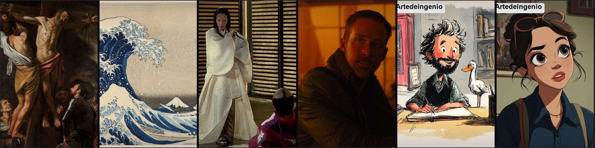

<div align="center">



# 예술 미학 스타일 라이브러리

**시각 스타일을 바로 조합할 수 있는 프롬프트 레이어로 분해합니다**

화파 · 드로잉 · 감독 · 카메라 — 네 개의 축, 하나의 구조

[English](README.en.md) · [日本語](README.ja.md) · [Français](README.fr.md) · [中文](README.md) · **한국어**

</div>

---

## 이것은 무엇인가

시각 스타일을 **일곱 개의 교체 가능한 레이어**로 나눈 Obsidian 기반 라이브러리입니다.

- 421개 화파
- 274개 드로잉 스타일
- 100개 감독/영화 스타일
- 157개 카메라 무브 레시피

레이어: **style / lighting / color / composition / medium / mood / camera**.

## 왜 유용한가

“예쁜 이미지”를 모으는 대신, 이미지가 **어떻게 구성되는지**를 기록합니다. 그래서 A 이미지의 조명을 B 이미지의 주제에 적용하거나, 같은 인물에 다른 화파의 색을 입힐 수 있습니다.

```bash
python3 artvault.py compose \
  "비 오는 네온 거리의 현상금 사냥꾼, 바로크 조명, 사이버펑크 구도" \
  --subject "a female bounty hunter in a wet neon alley"
```

## 사용 방법

- Obsidian으로 저장소 루트를 엽니다.
- `python3 artvault.py` CLI로 레이어를 조회·조합합니다.
- DSH / MCP / Agent Skill에서 검색·호출할 수 있습니다.
- 이미지 생성 도구가 아니며, 출력은 텍스트 프롬프트입니다.

## 구성

| 축 | 내용 |
|---|---|
| 화파 | 미술사와 시각 언어 |
| 드로잉 | 손그림·일러스트 스타일 |
| 감독 | 영화적 스타일과 조명 |
| 카메라 | 카메라 무브와 구도 |

## 문서

- [English](README.en.md)
- [日本語](README.ja.md)
- [Français](README.fr.md)
- [中文](README.md)

## 라이선스

개인 연구·학습용입니다. 이미지와 텍스트의 권리는 각 원권리자에게 있으며, 상업적 사용 전에는 별도 허가가 필요합니다. 자세한 내용은 [LICENSE](LICENSE)를 확인하세요.

---

<p align="center"><sub>Art Aesthetic Vault · Visual style as composable layers</sub></p>
